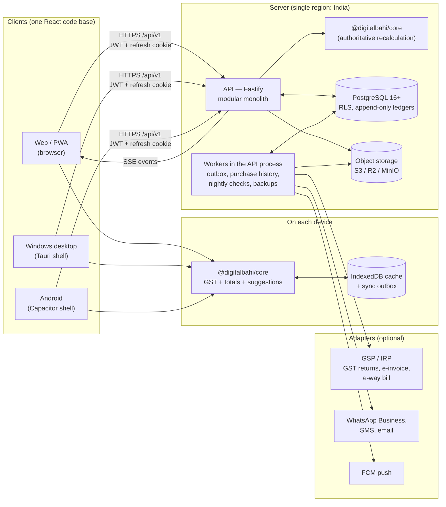
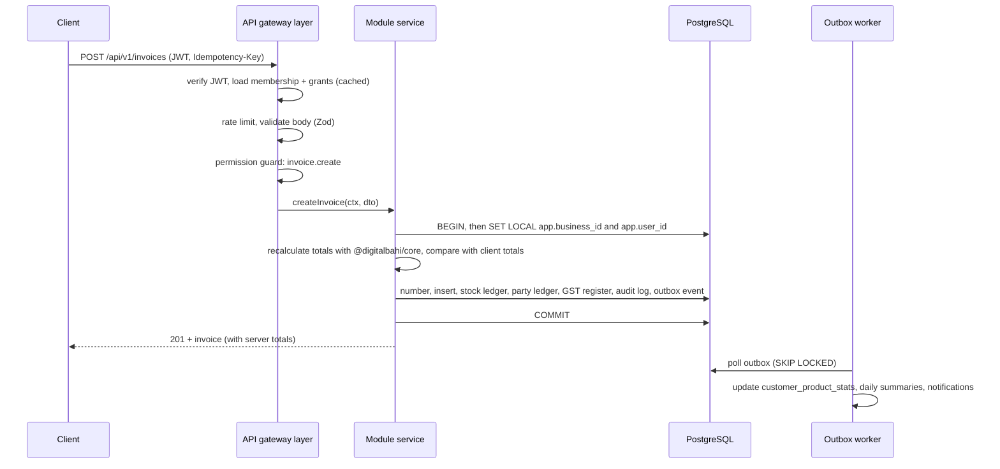
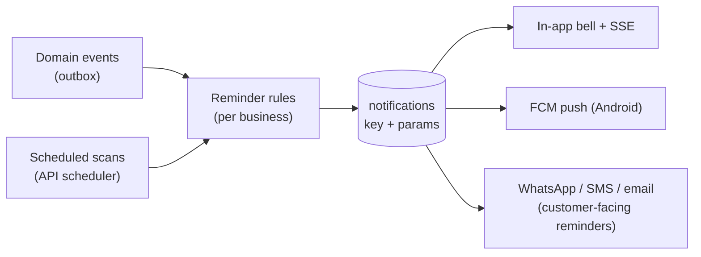

# A. Product architecture

This document describes how Digital Bahi is put together: the pieces, how they talk, where each kind of logic lives, and how the system grows from one distributor on a ₹1,500/month server to a multi-tenant SaaS without a rewrite.

## 1. Who we are building for

A small or mid-sized Indian distributor or wholesaler:

| Dimension | Typical size | Design consequence |
|---|---|---|
| Products | 1,000–10,000 SKUs from 10–60 companies | Product search must be instant: the catalogue is cached on the device |
| Customers | 300–5,000 retailers on 5–30 beats (routes) | Customer lists sort by outstanding without aggregating the ledger |
| Invoices | 50–1,500 per day, 5–40 lines each | Invoice posting must be one short DB transaction |
| Users | 3–50 (owner, accountant, salespeople, warehouse, drivers) | Role-based permissions; phones as first-class clients |
| Connectivity | Office broadband; salespeople on patchy 4G | Daily operations work offline and sync later |
| Compliance | GST (CGST/SGST/IGST, HSN, returns), often e-invoicing | GST rules are data, not code |

The daily loop that must be fastest and most reliable: **Order → Invoice → Stock → Collection**, with the customer's outstanding and credit visible at every step.

## 2. Architectural principles

1. **Modular monolith first.** One deployable API, split internally into business modules with explicit boundaries. Microservices would multiply cost and operational load for a team and customer base this size. Module boundaries are drawn so any module could be extracted later.
2. **One calculation engine, everywhere.** Money, GST, stock and suggestion logic lives in `@digitalbahi/core`, a pure TypeScript package with no I/O. The browser, the phone (offline) and the server run the same code, so an invoice built offline has exactly the totals the server recomputes.
3. **The database protects the money.** Financial and stock invariants are enforced by PostgreSQL (constraints, append-only triggers, period locks, row-level security), not only by application code.
4. **History is immutable.** Ledgers are append-only; posted documents are cancelled, never deleted; document lines store a snapshot of the tax that was charged.
5. **Rules are configuration.** GST rates, thresholds, numbering patterns, credit policy, negative-stock policy and workflow steps are data with effective dates, editable without a deploy.
6. **Offline for the daily loop, online for everything else.** See [10-offline-sync.md](10-offline-sync.md).
7. **Localisation from line one.** Every user-visible string, error and notification is a translation key. See [05-design-system.md](05-design-system.md#8-localisation).

## 3. System overview



### Components

| Component | Responsibility | Scales by |
|---|---|---|
| **Web client** (`apps/web`) | All screens; responsive from 360 px phones to 1920 px desktops; PWA install; offline cache | CDN / static hosting |
| **Desktop shell** (`apps/desktop`, Tauri) | Wraps the web build for Windows: native printing to thermal/A4 printers, local backup folder, auto-update | — |
| **Android shell** (`apps/mobile`, Capacitor) | Wraps the web build: ML Kit barcode camera, Bluetooth printer, share sheet, push notifications | — |
| **API** (`apps/api`, Fastify) | Authentication, authorisation, validation, business services, transactions, audit | Horizontal (stateless); 2+ instances behind a load balancer |
| **Workers** (loops in the API process today: `services/outbox-worker.ts`, `nightly-analytics.ts`, `backup-schedule.ts`) | Transactional outbox consumer, purchase-history stats, association mining, drift and balance checks, automatic backups; later reminders, report exports, integration calls | Any number of API servers run them side by side (rows are claimed); each loop can be switched off per server (`…_SECONDS=0`) or moved to its own process |
| **PostgreSQL** | System of record; integrity rules; reporting summaries | Vertical first, then read replica for reports, then partitioning of ledgers |
| **Object storage** | Product images, receipts, PDFs, proof of delivery, backup archives | Managed service |
| **Integration adapters** | GST filing via a GSP, e-invoice via IRP, e-way bill, WhatsApp/SMS/email, payments/UPI | One adapter per provider behind an interface |

## 4. Code organisation

```
BillingSystem/
├── apps/
│   ├── web/                 React 19 + Vite PWA — live on the API (demo mode for previews)
│   ├── api/                 Fastify modular monolith — built in Phase 3
│   ├── desktop/             Tauri 2 shell for Windows — Phase 6
│   └── mobile/              Capacitor shell for Android — Phase 5/6
├── packages/
│   ├── core/                Pure domain logic (built): money, GST engine, invoice totals,
│   │                        numbering, stock rules, receivables, credit, order workflow,
│   │                        suggestions, search ranking, validators, RBAC catalogue
│   ├── i18n/                Translation catalogues + Indian formatting (built)
│   ├── db/                  Drizzle schema, SQL migrations, seeds, integration tests (built)
│   └── contracts/           Zod request schemas and response types shared by API and clients (built)
└── docs/                    This design
```

Dependency rule (enforced in CI with an import linter): `apps/* → packages/*`; `packages/db → packages/core`; `packages/core` depends on nothing but `decimal.js`. The UI never imports `packages/db`.

### API modules (`apps/api/src/modules/*`)

Built in Phase 3: `health`, `identity` (OTP, sign-up, login, refresh rotation, businesses, `/me`), `team` (members, roles, permissions), `audit-log`, `business` (profile, settings, number series, godowns), `catalog` (units, brands, categories, rate lists, tax categories/rates, products, catalogue snapshot), `parties` (customers, suppliers, routes, statements), `invoices` (posting, preview, cancel, suggestions, customer insight), `purchases`, `inventory` (stock, stock ledger, adjustments), `payments` (receipts, supplier payments, allocation, cheques, accounts), `reports` (dashboard, reports, GST summary, search). Shared flows are in `apps/api/src/services` (numbering, stock, party ledger, payments, settings, sales document, tenant ownership checks).

The full target list — each module owns its tables, its services and its routes:

```
modules/
  auth/          login, OTP, refresh rotation, devices
  access/        users, roles, permissions, memberships
  settings/      typed business settings, document series
  catalog/       products, units, brands, categories, prices, tax categories & rates, batches
  parties/       customers, suppliers, routes, categories
  sales/         sales orders, invoices, credit/debit notes (customer side)
  purchases/     purchase bills, purchase returns
  fulfilment/    packing, dispatch, delivery
  inventory/     stock ledger, balances, adjustments, transfers
  payments/      receipts, supplier payments, allocations, payment accounts, party ledger
  gst/           GST register, return periods, formatters/exports, filing adapters
  hr/            employees, attendance, leave
  payroll/       salary structures, payroll runs, slips, advances
  expenses/      expenses, categories
  reports/       report definitions, summary tables, exports
  intelligence/  purchase-history stats, associations, suggestion endpoint
  notifications/ in-app notifications, reminder rules, channels
  sync/          offline pull/push protocol
  audit/         audit log writer and viewer
  backup/        backup, restore
  files/         uploads, signed URLs
```

Inside a module (as built):

```
modules/invoices/
  routes.ts          Fastify plugin: routes with Zod schemas, guard(deps, permission), one withTenant transaction per request
  suggestions.ts     customer insight + suggestions
services/
  sales-document.ts  prices and taxes a sale from server data only (shared by preview and posting)
  stock.ts           postStockMovement(tx, …): the only way stock changes
  party-ledger.ts    postPartyEntry(tx, …): ledger row + cached balance
  payments.ts        recordPayment(tx, …): numbering, allocation, ledger
test/invoices.test.ts   integration tests against PostgreSQL through the real HTTP app
```

**Cross-module calls** go through exported service functions that take the open transaction (e.g. `postStockMovement(tx, movement, policy)`), so a sale and its stock movement commit together. Modules never write each other's tables directly. **Asynchronous side effects** (stats, notifications, report summaries) go through domain events in the transactional outbox.

### Adding a module

1. Add tables in `packages/db/src/schema/<module>.ts`, run `pnpm db:generate` to create the migration.
2. Add permissions to `PERMISSION_CATALOG` in `packages/core` (they are synced to the DB on deploy; roles pick them up by wildcard or by admin choice).
3. Add `apps/api/src/modules/<module>` (a Fastify plugin) and add it to `MODULES` in `apps/api/src/modules/index.ts`.
4. Add translation keys to `en.json` and `hi.json` (the parity test lists anything missing).
5. Add one entry to the client module registry (`apps/web/src/app/modules.ts`); navigation, command palette and permission-based visibility follow automatically.

Nothing existing is edited, which keeps the change small and safe.

## 5. Request lifecycle



Every request carries a `requestId` (also written to audit rows and logs) so a support query can follow one action end to end.

## 6. The critical transactions

All of these run in **one** database transaction at `READ COMMITTED` with explicit row locks. They are the heart of the product and get the most tests.

**Post a sales invoice**
1. Lock the document series row (`UPDATE document_series SET next_number = next_number + 1 … RETURNING`) and format the number (`formatDocumentNumber`). Numbers are gap-free because the increment rolls back with the transaction.
2. Resolve tax per line (`resolveTax` on the invoice date), compute totals (`calculateDocument`), reject if the client's totals differ (`compareTotals`).
3. Check credit (`evaluateCredit`) and stock (`checkStock`) against the business's configured policies (`allow` / `warn` / `block`).
4. Insert invoice + lines (with tax snapshot and `tax_engine_version`).
5. For each line: lock `stock_balances` (`SELECT … FOR UPDATE`), insert a `stock_ledger` row with the new running balance, update the balance.
6. Insert a debit in `party_ledger_entries`; update `customers.balance`.
7. Insert one `gst_transactions` row per line.
8. Allocate any amount received (`payments` + `payment_allocations`).
9. Write `audit_logs` and an `invoice.posted` outbox event.

**Cancel an invoice** — allowed only if the GST period is open (DB-enforced) and within the configured edit policy: status → `cancelled`, reversing stock ledger rows (`sale_return`), a reversing party-ledger credit, GST register rows flagged `is_cancelled`, allocations released. The number stays used.

**Post a purchase** — mirror image: stock in (with batch/expiry), moving-average cost update (`movingAverageCost`), supplier ledger credit, inward GST rows with ITC eligibility. The unique index on `(supplier, supplier_invoice_number, FY)` stops the same bill being entered twice.

**Receive a payment** — payment row, allocations (oldest due first by default, `allocatePayment`), invoice `amount_paid`/`balance_due`/`payment_status` updates, party-ledger credit, cached balance update. Locks are taken party first, then its open documents, then the number series, so a payment and an invoice-with-payment for the same customer never deadlock.

**Stock adjustment / transfer** — never a direct balance edit: always ledger rows with a reason code, approval where configured, audit log.

Deadlock avoidance: rows are always locked in a stable order (series → balances ordered by `product_id, warehouse_id, batch_id` → party).

## 7. Reporting architecture

Reports must stay fast with years of data, without a separate data warehouse on day one.

| Layer | What | Freshness |
|---|---|---|
| Transactional tables | Invoices, lines, ledgers, GST register | Real time |
| Summary tables | `customer_stats`, `customer_product_stats` (built); `sales_daily_product`, `sales_daily_customer` (planned: reports read the documents today) | Seconds (outbox worker); rebuilt and checked for drift nightly |
| Report service | Declarative report definitions (dimensions, measures, filters) compiled to SQL over summaries, falling back to base tables for detail | — |
| Exports | Excel (ExcelJS), CSV, PDF (HTML template → headless Chromium) generated by workers, stored in object storage, link notified to the user | Async for large ranges |

Dashboards read summary tables and cached balances only. When the database grows (roughly beyond 50 GB or when reports start competing with billing), reports move to a read replica with no code change other than the connection used by the report service. Ledgers (`stock_ledger`, `party_ledger_entries`, `audit_logs`, `gst_transactions`) are partitioned by month once they pass tens of millions of rows.

## 8. File storage

Files never go through the API as blobs. The client asks `POST /files` for an upload slot, the API validates type and size, returns a pre-signed PUT URL with the exact content type and a max length, and records a `files` row (purpose, owner, SHA-256). Buckets are private; reads use short-lived signed GET URLs issued after a permission check. A worker scans uploads (ClamAV) and generates image thumbnails. Single-server installs use a local-disk adapter with the same interface.

## 9. Notification system



* **Event-driven** reminders: order waiting for packing, leave request submitted, payment received.
* **Scheduled** scans (configurable time, default 08:00 IST): customer payments due in N days / overdue, supplier payments due, low stock, batches expiring within N days, salary due, orders pending more than N hours.
* Notifications store a translation key and parameters, never rendered text, so each user reads them in their own language; `dedupe_key` stops the same reminder twice.
* Customer-facing messages (payment reminders on WhatsApp) use pre-approved templates in both languages and respect per-customer opt-out.

## 10. Localisation architecture

* Catalogues live in `packages/i18n/src/locales/<code>.json` (English is the source). Keys are type-checked at compile time; a test fails the build if any language misses a key or uses different placeholders.
* Numbers, currency and dates use the Indian system (`₹12,34,567.00`, `dd/mm/yyyy`) through `@digitalbahi/i18n` formatters.
* Domain errors carry a code and parameters (`INSUFFICIENT_STOCK {product, available}`), translated on the client. The API never sends English sentences as the only error information.
* Product master data has an optional local-language name (`name_local`) and search aliases (`"namak"`, `"नमक"`), used by search and by Hindi invoices.
* Invoices have their own print language, independent of the user's UI language.
* Adding Marathi, Gujarati or Tamil = a new JSON file, one registry entry, and (for invoices) number words in `@digitalbahi/core`.

## 11. GST architecture (summary)

Calculation (`@digitalbahi/core`), recording (`gst_transactions`), reporting (queries) and filing/export (versioned formatters and provider adapters) are four separate layers. Rates and thresholds are effective-dated data. Details: [08-gst-architecture.md](08-gst-architecture.md).

## 12. Authentication and authorisation (summary)

Short-lived JWT access tokens plus rotating refresh tokens; argon2id passwords; mobile OTP; role-based permissions with wildcards, field-level rules (e.g. purchase cost hidden from sales staff) and PostgreSQL row-level security per business. Details: [09-security.md](09-security.md).

## 13. Deployment

| Stage | Topology | Indicative cost |
|---|---|---|
| **Single distributor / pilot** | One VPS in Mumbai (4 vCPU, 8 GB): Docker Compose with Caddy (auto HTTPS), API + worker, PostgreSQL, MinIO. Nightly encrypted backup to object storage in another region | ₹1,500–3,000 / month |
| **SaaS, first 100 businesses** | 2 API instances + 1 worker on a container platform, managed PostgreSQL (with PITR), managed object storage, CDN for the web app | ₹15,000–40,000 / month |
| **Growth** | Read replica for reports, ledger partitioning, dedicated worker pools per queue, Redis only if caching/rate limiting outgrows PostgreSQL | scales with usage |

Data stays in Indian regions by default (customer expectation and a DPDP Act consideration). Releases: migrations run first (backward-compatible, expand/contract), then API, then web; the desktop and Android shells auto-update the web bundle they carry.

## 14. Observability

Structured JSON logs (pino) with `requestId`, `businessId`, `userId` and no personal data in messages; **built:** an error log of every failure (API 500s, browser crashes sent to `POST /client-errors`, background jobs, lost database connections, unhandled rejections) in daily files, each entry with what happened in plain words, the source file and line (browser errors mapped through the web build's source maps, kept on the API and off the public site), the request or screen, the person and the reference they were shown, and `pnpm errors` / `node dist/errors.js` to summarise it; OpenTelemetry traces for API and jobs; error tracking (Sentry); business health checks (outbox lag, failed jobs, ledger-vs-balance drift detected by the nightly verifier, sync queue age per device).
