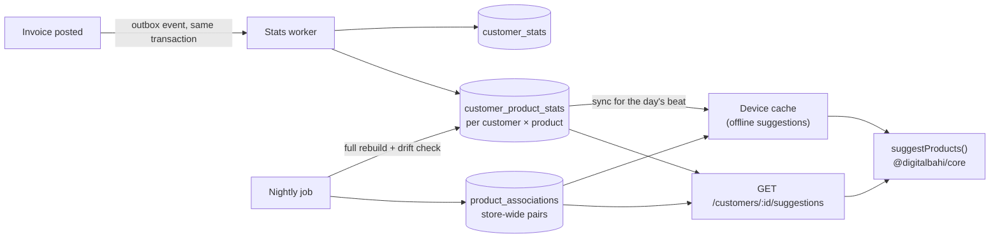

# G. Invoice intelligence: how purchase-history suggestions work

Implementation: `packages/core/src/suggestions/` (`stats.ts`, `associations.ts`, `engine.ts`) and `packages/core/src/search/products.ts`, covered by `packages/core/test/suggestions-search.test.ts`; on the server (Phase 5.1) `apps/api/src/services/purchase-history.ts` (stored figures), `outbox-worker.ts` and `nightly-analytics.ts`, with the endpoints in `apps/api/src/modules/invoices/suggestions.ts`, covered by `apps/api/test/purchase-history.test.ts` and the browser flow `apps/web/e2e/purchase-history-flow.mjs`. The prototype's invoice screen runs the same core code on six months of sample history.

## 1. Promise to the user

1. **Recommend, never act.** No product is ever added to a bill automatically. Every suggestion needs a click (or Alt+1…9).
2. **Always say why.** Each suggestion carries machine-readable reasons shown in the user's language: *"Usually every 7 days · last bought 6 days ago"*, *"Bought in 14 of last 27 orders"*, *"37% of customers who buy Parle-G also buy this"*, *"Stopped buying? Usually every 7 days, last 31 days ago"*.
3. **Be fast.** Suggestions appear the moment a customer is selected (< 50 ms), online or offline.
4. **Be boring and predictable.** Transparent statistics, not a black box. Scores are simple enough to explain to a salesperson in one sentence.

## 2. Data pipeline



* The invoice screen never scans years of invoice lines. It reads **one small, indexed table** (`customer_product_stats`, typically 20–200 rows per customer) plus a few association rows.
* Stats update a few seconds after each invoice (outbox worker) and are rebuilt from scratch every night, so a bug or missed event self-heals.
* Salespeople's phones sync stats for customers on today's route, so suggestions work offline. *(Planned with offline sync, 5.3/5.4; today the device keeps the insight of the customers it opened.)*

**As built (Phase 5.1).**

* **Worker.** Every few seconds (`OUTBOX_WORKER_SECONDS`, default 5) the API takes each business's waiting `outbox_events` (`FOR UPDATE SKIP LOCKED`, so several servers can share the work). For an `invoice.posted` / `invoice.cancelled`, a payment received, cancelled or bounced, and a credit or debit note posted or cancelled, it works out that customer's figures again — **whole**, from their posted bills in the window, with the same `computeCustomerStats` the app runs — and replaces their `customer_product_stats` rows and `customer_stats` row (with purchase summary, sales, overdue amount, payment behaviour, the customer's own "bought together" rules and `as_of`, the day they are for). A per-customer advisory lock keeps two writers apart. A customer that fails is rolled back alone (savepoint) and their events are tried again after 1, 2, 4 … minutes, then set aside after 8 failures with the error kept; every failure is in the error log.
* **Reading.** `GET /customers/:id/insight` (the billing screen) and `/suggestions` use the stored figures while they are at most two days old (`source: "stored"`), and otherwise work them out on the spot (`source: "live"`, nothing written). Both go through the same rounding as the columns, so the two give identical answers. For a customer with 360 bills of 15 lines a year, `/suggestions` took 7 ms at the 95th percentile from stored figures against 95 ms worked out live (`/insight`: 16 ms against 111 ms), on a laptop-class container.
* **Nightly** (after `NIGHTLY_ANALYTICS_HOUR`, default 2:00, in each business's time zone; claimed by inserting the business's `analytics_runs` row for the day, so it runs once even with several servers): it first handles the business's waiting events, then for every customer with stored figures **works them out again for the day they were stored for and compares** (drift check — any difference means the worker missed something), rebuilds everyone for today (the window moves on daily), mines the store-wide rules (last 180 days, at most 50,000 bills) into `product_associations`, checks cached balances against their ledgers (`customers.balance` and `suppliers.balance` against `party_ledger_entries`, `stock_balances` against `stock_ledger`), and deletes processed outbox events older than 30 days. Drift and mismatches are kept in `analytics_runs.details` with examples and written to the error log; nothing is silently "fixed" but the derived figures. The 360-bill business above took 0.2 s.
* Returns (credit notes) do not lower the quantities bought; a return or a payment only refreshes the customer's figures.

## 3. Per-customer statistics (`computeCustomerStats`)

Input: the customer's invoice lines in a window (default **365 days**, setting `suggestions.window_days`). Several lines of the same product on one invoice are merged. Cancelled invoices are excluded.

For each product the customer bought:

| Statistic | Definition | Example (milk, ABC General Store, sample data) |
|---|---|---|
| `orderCount` | distinct invoices containing the product | 27 |
| `orderShare` | `orderCount / customer's invoice count` in the window | 27 / 27 = 1.00 |
| `totalQty`, `avgQty` | sum and mean of quantity per invoice | — , 24 |
| `lastQty`, `lastRate` | from the most recent invoice | 24, ₹64 |
| `firstPurchasedOn`, `lastPurchasedOn` | dates | 6 days ago |
| `daysSinceLast` | today − last purchase | 6 |
| `typicalIntervalDays` | **median** gap between consecutive purchase dates; only when there are **≥ 2 gaps (≥ 3 purchases)** — two purchases are not a habit | 7 |
| `recentQtys` | last 5 quantities, newest first | 24, 24, 24, 24, 24 |

Median, not mean, so one festival bulk order or one missed week does not distort the rhythm.

Customer-level summary: invoice count, first/last invoice, typical visit interval (median gap between visits), average order value, payment behaviour.

**Suggested quantity** (`suggestedQty`): the **median of the last three quantities**, rounded **up** to the product's order multiple (case size) when one is set. Robust to a one-off bulk order and always a quantity the warehouse can actually pick.

## 4. Where a habit is in its cycle (`reorderStatus`)

`ratio = daysSinceLast / typicalIntervalDays`

| Ratio | Status | Meaning | Shown as |
|---|---|---|---|
| < 0.75 | `upcoming` | Not due yet | Only in the reorder table |
| 0.75 – 1.15 | `due` | Normal reorder time | "Usually every 7 days · last bought 6 days ago" |
| 1.15 – 2.5 | `overdue` | Should have reordered | "Usually every 7 days · not bought for 12 days" |
| 2.5 – 6 | `lapsed` | Habit may have stopped (lost to a competitor? out of stock last time?) — useful for the salesperson to ask | "Stopped buying? Usually every 7 days, last 31 days ago" |
| > 6 | — | Habit is gone; not suggested | — |

The user's example — *milk every 7 days, last bought 6 days ago* — is ratio 0.86 → **due**.

## 5. Suggestion providers

The engine is a list of providers; each returns candidates `{ productId, group, score 0..1, reasons, suggestedQty }`. New suggestion types are new providers; nothing else changes.

| Provider | Selects | Score (0..1) | Reason code(s) |
|---|---|---|---|
| **Reorder** | products with a typical interval whose status is due / overdue / lapsed | due: `0.8 + 0.2·min(1, ratio)`; overdue: `1 − (ratio − 1.15)·0.15`; lapsed: `0.35` | `due`, `overdue`, `lapsed` `{intervalDays, daysSince}` |
| **Frequent** | `orderCount ≥ 2` and `orderShare ≥ 0.25` | `orderShare` | `frequent {count, total}` |
| **Bought together** | for each product already on the bill, rules A → B with B not on the bill | rule confidence (customer's own combos × 1.2) | `together {withProductName, percent, scope: customer \| all}` |
| **Last order** | products on the customer's most recent invoice | 0.5 | `last_order {daysAgo, qty}` |

### Frequently bought together (`mineAssociations`)

Nightly, over all invoice baskets of the last 180 days (baskets larger than 60 lines are ignored as noise):

* `support(A→B) = baskets with A and B / all baskets`
* `confidence(A→B) = baskets with A and B / baskets with A` — "of customers who buy A, how many also buy B"
* `lift(A→B) = confidence / (baskets with B / all baskets)` — > 1 means a real affinity, not just that B is popular

Kept only if `pairCount ≥ 5`, `confidence ≥ 0.25`, `lift ≥ 1.3`; at most 10 related products per product (highest lift × confidence). The same miner also runs on **each customer's own invoices** with stricter thresholds (`pairCount ≥ 3`, `confidence ≥ 0.6`, `lift ≥ 1.05`; kept in `customer_stats.associations`) to find their personal combinations ("usually bought with bread by this customer"). Until the first nightly run, the store-wide rules are mined on request from the last 3,000 bills and kept for 15 minutes.

## 6. Merging and ranking (`suggestProducts`)

```
final score(product) = Σ over providers  weight(provider) × provider score
weights (setting suggestions.weights): reorder 1.0 · frequent 0.6 · together 0.5 · last_order 0.3
```

Then:
1. **Exclude** products already on the bill and inactive products.
2. **Stock:** out-of-stock products are **kept but halved in score and flagged** ("Out of stock") — the salesperson may still take the order or offer an alternative; low stock is flagged ("Low stock: 28 left").
3. All reasons are kept (the "why?" popover lists every one); the **group** (tab) is the provider that contributed most.
4. Sort by score, then name; return the top N (24 on the invoice screen).

Worked example (ABC General Store in the prototype's sample data: 27 invoices, weekly visits, last visit 6 days ago):

| Product | Reorder | Frequent | Last order | Final | Tab |
|---|---|---|---|---|---|
| Amul Taaza Milk | due, 6/7 = 0.86 → 0.97 × 1.0 | 1.00 × 0.6 | 0.5 × 0.3 | **1.72** | Reorder due |
| Amul Butter | due 0.97 × 1.0 | 0.96 × 0.6 | 0.5 × 0.3 | **1.70** | Reorder due |
| Coca-Cola | lapsed (31 days, usually 7) 0.35 × 1.0 | 0.85 × 0.6 | — | **0.86** | Frequently bought |
| Parle-G | not due (bought 6 days ago, usually every 13) | 0.52 × 0.6 | 0.5 × 0.3 | **0.46** | Frequently bought |

## 7. The reorder table (`buildReorderList`)

Every product the customer buys repeatedly (≥ 2 orders), most urgent first (overdue → due → upcoming → lapsed → occasional):

| Product | Last qty | Last purchase | Typical interval | Suggested qty | Status |
|---|---|---|---|---|---|
| Amul Taaza Milk | 24 | 6 days ago | 7 days | 24 | Due now |
| Britannia Bread | 10 | 6 days ago | 7 days | 10 | Due now |
| Parle-G | 20 | 6 days ago | 13 days | 24 (two cases of 12) | Upcoming |
| Coca-Cola | 12 | 31 days ago | 7 days | 12 | Lapsed |

Each row has an **Add** button. It appears in the invoice suggestions (Reorder tab → table view), on the customer profile, and in the salesperson's route plan. The API serves it per customer (`GET /customers/:id/reorder`) and across customers (`GET /reorder/due?routeId=&salespersonId=`: everyone with a due, overdue or lapsed habit, most urgent first, from the stored figures), which the route plan (5.4) will show.

## 8. Product search ranking (`searchProducts`)

The active catalogue is cached on the device and searched locally (a few ms for 10,000 products):

| Match | Score |
|---|---|
| Exact barcode | 1000 (a scanner's Enter adds it immediately) |
| Exact code / SKU | 900 / 850 |
| Code / SKU prefix | 400 / 350 |
| Name equals / starts with query | 300 / 220 |
| All query words match word starts / substrings | 120 + 20 per word-start match |
| Query found with spaces and punctuation removed (`parleg` → "Parle-G") | 90 |
| Local-language name or alias (`नमक`, `namak`) | same scale − 5 |
| Brand match | half weight |
| **Boosts:** this customer's order share × 80; bought recently +15; **out of stock** −40 | |

## 9. Explanations and language

Reasons are stored and transmitted as `{ code, params }` and rendered with translation keys (`suggestions.reason.due`, …) in English or Hindi:

| Code | English | हिन्दी |
|---|---|---|
| `due` | Usually every {{intervalDays}} days · last bought {{daysSince}} days ago | आमतौर पर हर {{intervalDays}} दिन में · पिछली बार {{daysSince}} दिन पहले |
| `frequent` | Bought in {{count}} of last {{total}} orders | पिछले {{total}} में से {{count}} ऑर्डर में खरीदा |
| `together_all` | {{percent}}% of customers who buy {{withProductName}} also buy this | {{withProductName}} खरीदने वाले {{percent}}% ग्राहक यह भी लेते हैं |
| `lapsed` | Stopped buying? Usually every {{intervalDays}} days, last {{daysSince}} days ago | खरीदना बंद किया? … |

## 10. Other smart suggestions (same engine, other screens)

| Suggestion | Where | Source |
|---|---|---|
| "Stock is below minimum level" | Dashboard, products, purchase entry (pre-filled reorder quantities per supplier) | `stockLevel`, `reorder_qty` |
| "Customer payment is overdue" | Customer card on the invoice, dashboard *Needs attention*, reminders | `evaluateCredit`, `ageDocuments` |
| "Customer may need to reorder" | Salesperson's route plan for the day, reminders | reorder list for customers on today's beat |
| "Batch expires in 12 days — sell first" | Packing (FEFO pick), product search | `allocateFefo`, `expiryState` |

## 11. Configuration

| Setting | Default |
|---|---|
| `suggestions.window_days` | 365 |
| `suggestions.weights` | reorder 1 · frequent 0.6 · together 0.5 · last_order 0.3 |
| Frequent threshold | order share ≥ 0.25 and ≥ 2 orders |
| Association thresholds | pair count ≥ 5, confidence ≥ 0.25, lift ≥ 1.3 (a customer's own: ≥ 3, ≥ 0.6, ≥ 1.05) |
| Out-of-stock factor | 0.5 |
| `OUTBOX_WORKER_SECONDS` (server) | 5 (0 = off on this server) |
| `NIGHTLY_SCHEDULER_SECONDS` · `NIGHTLY_ANALYTICS_HOUR` (server) | 600 · 2 |

## 12. Measuring whether it helps

`POST /suggestions/feedback` records impressions and adds (product, reason, rank). *Built (5.1):* the billing screen keeps, per bill, the suggestions that were on screen (first appearance of each, with its position in the whole list and its reason codes) and the ones added from them, and sends both once the bill is saved online (none for a bill saved offline or not saved; a taken suggestion later removed from the bill does not count). One `suggestion_feedback` row per bill; `GET /suggestions/feedback/summary?from=&to=` gives offered, taken and acceptance by reason and by position (1–3, 4–6, 7–12, 13+) and the share of bill lines that came from suggestions. Planned: time to complete an invoice and — the real goal — lines per invoice and reactivation of lapsed habits, and weights tuned per business from these numbers (today they are the `suggestions.weights` setting); a learned model (e.g. gradient-boosted ranking on the same features) can replace the weighted sum later behind the same provider interface, as long as it still produces reasons.

## 13. Cold start and edge cases

* **New customer (< 2 invoices):** no reorder/frequent suggestions; *bought together* works as soon as the first product is on the bill; the product search still ranks store-wide best sellers.
* **Walk-in / cash customer:** suggestions off by default (the history mixes many people).
* **Price change:** the suggested quantity is unaffected; the line is priced from the current rate list, not the last rate.
* **Product replaced by a new SKU:** a `replaces_product_id` mapping (Phase 5) carries history over.
* **Privacy:** statistics are per business and never shared across businesses.
