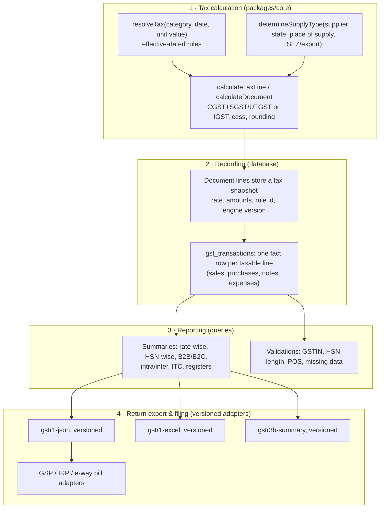

# H. GST architecture

GST rules change: rates are rationalised (the September 2025 reform moved most goods to 5 % and 18 % slabs with a 40 % slab for a small set), thresholds move (the B2C-large invoice limit dropped from ₹2.5 lakh to ₹1 lakh in 2024), return formats gain tables and sections. The design goal is simple: **a rule change is a data change or a new formatter version, never an edit to posted data and rarely a code deploy.**

> Rates, thresholds and dates quoted in this repository (seed data, sample products, tests) are examples of how the system stores rules. Before go-live, every value is verified against the current CBIC notifications and GSTN specifications, and maintained from then on as dated configuration.

## 1. Four separate layers



| Layer | Owns | Changes when |
|---|---|---|
| **Calculation** | How tax is computed on a line and a document | Calculation method changes (rare). Bumps `TAX_ENGINE_VERSION`, stored on every document |
| **Recording** | What was actually charged, as immutable facts | Never retroactively. New columns via additive migrations |
| **Reporting** | Aggregations and checks over the facts | New report or check needed |
| **Export / filing** | Mapping facts to a specific return format and provider API | Government changes a format or threshold → new formatter version / config row |

## 2. Tax calculation

### 2.1 Where the rate comes from

A product references a **tax category** (e.g. *Biscuits & confectionery*, *Aerated beverages*, *Nil rated — fresh milk, salt, bread*). The category has **effective-dated rules** (`tax_rates`):

| Field | Purpose |
|---|---|
| `effective_from`, `effective_to` | Validity window (inclusive). Back-dated invoices resolve the rule valid on their own date |
| `gst_rate` | Total rate (IGST equivalent) |
| `cess_rate`, `cess_per_unit` | Ad-valorem and specific compensation cess |
| `condition` | Optional value condition, e.g. `{"unitValueLte": 2500}` for slabs that depend on the price per piece |
| `priority` | Tie-break between overlapping conditional rules |
| `reference` | Notification / circular number for the audit trail |

`resolveTax(category, { date, unitValue, unitValueIncludesTax })`:
1. Non-taxable kinds (`exempt`, `nil_rated`, `non_gst`, `zero_rated`) return zero tax but keep their kind (they are reported separately).
2. Rules in force on the date are filtered by condition (for tax-inclusive prices the condition is tested on the tax-exclusive value of each candidate rule).
3. Highest priority wins, conditional rules beat catch-alls, then the latest `effective_from`.
4. No rule → `TAX_RULE_NOT_FOUND` with the category and date: the invoice cannot be saved with a guessed rate.

Admins cannot save overlapping unconditional rules (`findOverlappingRules`).

**When the government changes a rate:** add a rule with the new `effective_from` (and close the old one), or move a group of HSN codes to another category in one bulk action. Products do not change; invoices dated before the change keep the old rate; invoices dated after get the new one — automatically, including invoices created offline.

Tested example (`packages/core/test/gst.test.ts`): biscuits at 18 % until 21-09-2025 and 5 % from 22-09-2025; apparel at 5 % up to ₹2,500 per piece and 18 % above.

### 2.2 Intra-state or inter-state

`determineSupplyType`:
* **Place of supply** for goods is where delivery ends: the ship-to address state (customer's state by default; a different ship-to address changes it; walk-in cash sales use the business's state).
* Same state as the supplier's registration → **intra-state**: CGST + SGST, or CGST + **UTGST** for Union Territories without a legislature (Chandigarh, Ladakh, Lakshadweep, Andaman & Nicobar, Dadra & Nagar Haveli and Daman & Diu, other territory) — taken from the `states` reference table, not hard-coded in components.
* Different state, **SEZ** recipients and **exports** → **inter-state**: IGST.
* The state code in a customer's GSTIN is checked against the chosen state (a common data-entry error).

### 2.3 Line and document arithmetic

* Exclusive prices: `taxable = qty × rate − line discount − share of invoice discount`.
* Tax-inclusive (MRP-style) prices: `taxable = round(net ÷ (1 + rate))`.
* Each component (CGST, SGST/UTGST, IGST, cess) is computed on the taxable value and **rounded to the paisa independently**, so CGST always equals SGST. (Consequence, tested: IGST 18 % of ₹1,254.40 is ₹225.79 while CGST 9 % + SGST 9 % is ₹112.90 + ₹112.90 = ₹225.80; the invoice round-off absorbs the paisa.)
* Invoice-level (pre-tax) discounts are apportioned across lines by net value with a largest-remainder method so no paisa is lost; GST is charged on the reduced value.
* Freight and other charges can be taxable (billed as part of the supply, at a configured rate) or non-taxable.
* Invoice round-off: none / nearest / up / down to a configurable step (default nearest ₹1), stored separately.
* **Bill of Supply:** composition dealers and unregistered businesses charge no tax (`documentKindFor`).
* The same function computes orders, invoices, purchases and credit/debit notes, on the client (live totals, offline) and on the server (authoritative); the server rejects any mismatch.

### 2.4 Snapshot on every line

Each posted line stores product name, HSN, UQC, taxability, `tax_category_id`, `tax_rate_id` (the rule applied), every rate and amount, and the document stores `tax_engine_version`, place of supply, supply type and the party's GSTIN/state as they were. Reprints and reports never recompute history with today's masters.

## 3. Recording: the GST register

On posting, the same transaction writes one `gst_transactions` row per taxable line with **facts only**:

`direction` (outward/inward) · `doc_type` (invoice, credit note, debit note, purchase, purchase notes, expense) · document number/date · original document for notes · `return_period` (YYYY-MM) · party name, GSTIN, registration type, state · place of supply · supply type · reverse charge · taxability · HSN · UQC · quantity · taxable value · rate · CGST · SGST/UTGST · IGST · cess · whole-document value · ITC eligibility (inward).

What it deliberately does **not** store: which return table a row belongs to (B2B vs B2CL vs B2CS, section numbers). That classification depends on thresholds and formats that change, so it is decided at export time by the formatter for that period.

Cancellation flags the rows (`is_cancelled`) — the only update the database allows on this table.

## 4. Reporting

| Report | Source |
|---|---|
| B2B / B2C split, intra / inter | party registration + GSTIN presence; supply type |
| Rate-wise summary | group by `gst_rate` |
| HSN-wise summary | group by HSN, UQC, rate (quantity, taxable, taxes) |
| Taxable value, CGST, SGST, IGST, total GST | sums per period |
| Credit notes / debit notes | `doc_type` |
| Sales GST vs purchase GST (ITC) | `direction` + ITC eligibility |
| Sales / purchase registers | line-level listing with filters |
| Documents issued | number ranges per series, with cancelled counts |

**Pre-export validation:** B2B rows without a valid GSTIN (checksum), GSTIN state ≠ place of supply for intra-state, missing or too-short HSN (required digits from dated config by turnover), notes without an original document, documents in a locked period that changed (impossible by trigger, still checked), negative taxable values.

## 5. Return export and filing

### 5.1 Versioned formatters

```ts
interface ReturnFormatter {
  id: string;                 // "gstr1-json"
  version: string;            // "2025.1"
  validFrom: string;          // first return period it applies to, e.g. "2025-04"
  returnType: "GSTR1" | "GSTR3B" | "HSN" | "REGISTER";
  format: "json" | "xlsx" | "csv";
  build(input: {
    period: string;
    business: BusinessGstProfile;
    rows: AsyncIterable<GstTransactionRow>;
    config: DatedGstConfig;   // thresholds etc. in force for the period
  }): Promise<{ file: Uint8Array; summary: object; warnings: Warning[] }>;
}
```

* A registry picks the formatter version valid for the **return period**, so re-generating an old period's return reproduces the old format.
* Thresholds come from `gst_config` (dated), e.g. `b2cl_invoice_threshold` (₹2.5 lakh → ₹1 lakh from Aug 2024), `hsn_min_digits` by turnover, e-invoice turnover threshold, e-way bill value threshold.
* When GSTN changes a format (for example the split of the HSN summary into B2B and B2C sections), a **new formatter version** is added with its `validFrom`; nothing else changes. Formatters are pure functions with golden-file tests per version.
* Every export is recorded in `gst_exports` with formatter id + version, summary, warnings and the file.

Outputs: GSTR-1 JSON (for the GST offline tool / portal upload), GSTR-1 Excel and CSV per section, GSTR-3B summary (outward taxable, zero-rated, nil/exempt, inter-state supplies to unregistered persons by state, eligible ITC), HSN summary CSV, sales and purchase registers.

### 5.2 Direct filing and e-documents (optional adapters)

| Integration | Route | Notes |
|---|---|---|
| GST returns (save/submit) | Through a licensed **GST Suvidha Provider (GSP)** API | Taxpayer authorises with the portal's OTP flow; session tokens stored encrypted server-side, never on clients |
| **E-invoicing** (IRN, signed QR) | Invoice Registration Portal (IRP) API via a GSP or directly where permitted | Required above the configured aggregate-turnover threshold; IRN, ack number/date and signed QR stored on the invoice; cancellation within the IRP's allowed window; reporting time limits kept in config |
| **E-way bill** | E-way bill API (often combined with IRN generation) | Triggered for consignments above the configured value threshold; number and validity stored on the invoice/dispatch |
| GSTR-2B reconciliation (Phase 5+) | Download via GSP | Match supplier invoices to purchase entries; flag missing ITC |

Each adapter implements one interface (`GstFilingProvider`, `EInvoiceProvider`, `EwayBillProvider`) so the provider can be switched. Credentials (GSP client secret, GST portal username, API tokens) live in the server's secret store, encrypted at rest, accessible only to the worker that calls the provider, and are never sent to clients or written to logs.

## 6. Period locking and corrections

* After filing GSTR-1 for a month, an accountant **locks** the period (`gst_return_periods`, permission `gst.lock_period`).
* A database trigger then rejects changes to tax-relevant fields of invoices dated in that month (number, date, customer, GSTIN, place of supply, taxable value, taxes, total, status). Payments against those invoices still work.
* Corrections after filing are made the way the law expects: **credit or debit notes** in an open period, referencing the original invoice.
* Unlocking is admin-only, requires a reason and is audit-logged.

## 7. Other GST situations handled

| Situation | Handling |
|---|---|
| Composition dealer (our business) | Bill of Supply, no tax charged, composition turnover reporting |
| Composition / unregistered supplier (purchase) | No ITC; recorded as inward supply from unregistered/composition |
| Reverse charge | `is_reverse_charge` on documents and register; liability reported separately |
| Nil-rated / exempt / non-GST | Tax category kind; reported in the nil/exempt section |
| SEZ / export | IGST (with or without payment of tax, per setting), zero-rated reporting |
| Free goods (schemes, "10 + 1") | `free_qty` moves stock without value; valuation for GST per configured policy |
| Sales returns | Credit note with stock movement, references the original invoice and its tax rates |
| Discounts after sale | Credit note without stock movement (financial credit note), configurable whether GST is reduced |
| Invoice number rules | Pattern validated for the current limits (≤ 16 characters; letters, digits, `/`, `-`) when the series is configured, and by a database check |
| Multiple GSTINs (branches in other states) | Each GSTIN is its own business in the system; inter-branch transfers are invoices between them |

## 8. Runbook: "the government changed a rule"

| Change | What to do | Code deploy? |
|---|---|---|
| Rate change for some goods | Add `tax_rates` rows with the effective date (or bulk-move HSNs to another category); preview affected products; publish | No |
| New cess or cess removed | Same, on the affected categories | No |
| Threshold change (B2CL, e-invoice, e-way bill, HSN digits) | Add a dated `gst_config` row | No |
| Return format change | Add a formatter version with `validFrom`; golden-file tests | Yes (small, isolated) |
| New document requirement (e.g. new field on invoices) | Additive migration + template change | Yes |
| Calculation method change | New `TAX_ENGINE_VERSION`; old documents keep theirs | Yes, with tests on both versions |
