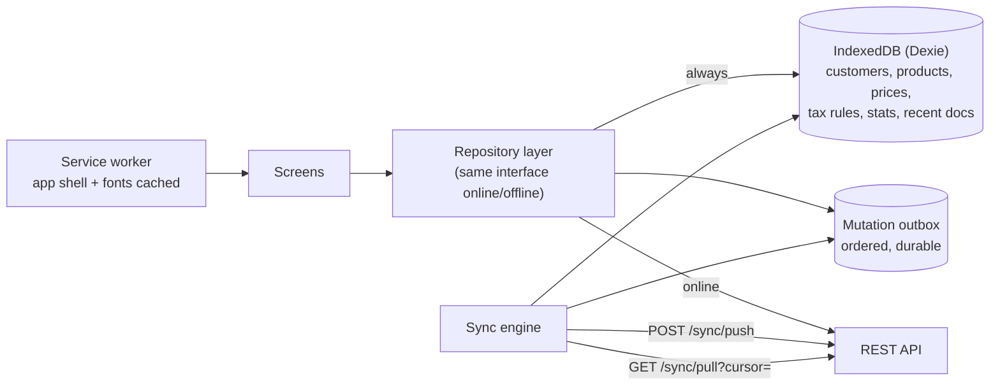

# Offline capability and synchronisation

Salespeople bill and collect in shops with weak 4G; a counter PC loses broadband for an afternoon. The daily loop must keep working. Everything else can wait for the connection.

## 1. What works offline

| Works offline | Why it is safe offline |
|---|---|
| **Create invoices** (numbered from the device's own series) | Totals and GST computed by the same `@vyapaar/core` engine the server uses; tax rules cached with their effective dates |
| **Create sales orders** | Orders do not move stock or money until confirmed online |
| **Receive payments / collections** | A receipt is a new, independent record; allocation is re-validated on sync |
| **Add / edit customers** (basic fields) | Versioned; conflicts resolved field by field |
| Search customers and products, see prices, stock (last synced), outstanding (last synced + local changes), purchase-history suggestions | Read-only cache |
| View recent invoices, print / share as PDF (rendered on the device) | Read-only |
| Packing counts (warehouse tablets) | Queued as quantities, validated on sync |

| Needs a connection | Why |
|---|---|
| Purchase entry, stock adjustments and transfers | They change cost and authoritative stock; one place of truth avoids double receipts |
| Cancelling or editing posted invoices, credit/debit notes | Must see the latest ledger, allocations and GST period locks |
| GST reports, exports, filing, e-invoice IRN, e-way bills | Need complete data and government APIs |
| Reports beyond the cached range, dashboards across the business | Need all data |
| Payroll, leave approval, user and role management, settings, backup/restore | Administrative, low frequency, security-sensitive |

The UI makes the state obvious: a sync chip (Online / Offline / Syncing · *3 changes waiting*), offline-only actions stay enabled, online-only actions are disabled with the reason, and offline saves say *"Saved offline · will sync when online"* (implemented in the prototype: Settings → simulate offline).

## 2. Client architecture

* **App shell** (HTML, JS, CSS, fonts, icons) is cached by the service worker (PWA) or bundled (Tauri/Capacitor), so the app starts without a network.
* **Cache scope** is limited by role and relevance: the full active catalogue with prices and tax rules (~1–2 MB for 10,000 products), customers on the user's routes (or all for counter PCs), their open invoices and purchase-history stats, recent documents (e.g. 60 days).
* **Mutation outbox:** every offline write is stored as `{ mutationId (UUIDv7), type, entityId, baseVersion, payload, createdAt }` and applied optimistically to the local cache.

## 3. Numbering invoices offline

GST requires invoice numbers to be unique within a financial year; a device cannot ask the server for the next number while offline. Two configurable strategies (`invoice.offline_mode`):

1. **Device series (default).** Each registered device gets a short code (`devices.series_code`, e.g. `A1`) and its own number series (`document_series.device_id`), e.g. `A1/26-27/0042`. Multiple series are permitted as long as each is consecutive and unique; the device allocates numbers locally, so they never collide with the office counter or other phones.
2. **Draft until sync.** Offline invoices are saved as drafts (printed as "estimate"), numbered from the main series when they reach the server. Suits businesses that want one series only.

## 4. Sync protocol

**Push** (`POST /sync/push`, batches in creation order):

1. The server checks `sync_mutations` by `mutationId`: already processed → return the stored result (idempotent replays after a dropped connection).
2. It re-validates the mutation exactly as an online request: permissions, the device still active, business rules (credit and stock policies), GST period not locked, totals recomputed with the server's `@vyapaar/core` (engine version and tax rules for the document date).
3. Result per mutation: `applied` (with server ids/versions), `rejected` (error code + params, e.g. `ALLOCATION_EXCEEDS_BALANCE`), or `conflict` (with the server's copy).

**Pull** (`GET /sync/pull?cursor=`): a change feed per business (`updated_at` + id cursor, plus tombstones for deletions and deactivations) for the cached entities, filtered to what this user may see.

Sync runs on reconnect, on app foreground, every few minutes while online, and on demand ("Sync now").

## 5. Conflict handling

| Data | Strategy |
|---|---|
| **Posted documents** created offline (invoices, receipts) | No conflicts by construction: they are new, immutable records with unique ids and device-series numbers. They can only be *rejected* by a business rule |
| **Business-rule failures** on sync (e.g. stock went negative with `block` policy, credit limit exceeded with `block`, GST period locked) | The document is accepted into a **"Needs review"** state (a `review_status` column added by the sync module's migration in Phase 5), not silently dropped: a manager sees it, with the reason, and approves (override permission) or converts it to a credit note / cancels. The salesperson is notified |
| **Master data** (customer phone, address) edited on two devices | Optimistic concurrency with `version`; non-overlapping fields merge automatically; the same field changed on both sides → the later change wins, the losing value is kept in the audit log and the editor is notified |
| **Payment allocations** | Re-allocated on the server if the target invoice was already settled; any remainder becomes an advance (never lost) |
| **Stock** | Never authoritative on a device. Offline screens show "stock as of 10:42" and include local unsynced sales; the server ledger decides |
| **Deleted / deactivated** masters | Tombstones in the pull feed; queued documents referencing them are still accepted (history), new ones are warned |

## 6. Security of offline data

Covered in [09-security.md](09-security.md#5-data-protection): encrypted cache with a key held in the OS keystore on desktop/Android, role-scoped content, wipe on logout, revocation or long inactivity; a revoked device's queued mutations are rejected.

## 7. Observability

Per device: last successful sync, queue length and age of the oldest pending mutation, rejected mutations. Admins get an alert when a device has not synced for N hours while holding unsynced invoices.
