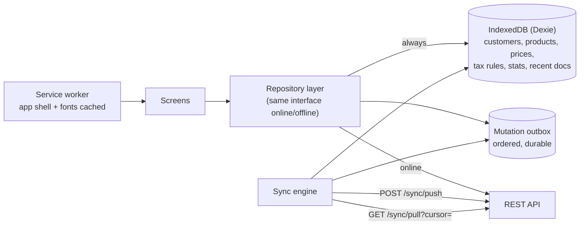

# Offline capability and synchronisation

Salespeople bill and collect in shops with weak 4G; a counter PC loses broadband for an afternoon. The daily loop must keep working. Everything else can wait for the connection.

## 0. What is built today

* **The app opens without a network.** The service worker serves the app; after every online start the business (profile, rules, permissions, catalogue with prices and tax rules, customers, suppliers, godowns) is kept on the device in IndexedDB (`apps/web/src/offline/snapshot.ts`). Without a server at start the app opens from that copy, shows *"No connection…"* and uses the device's calendar date in the business time zone. It looks for the server when the network returns and every 30 seconds, and continues in the background (a bill being typed stays on screen).
* **Bills without a connection, numbered by the device.** Every browser or phone of a user who may bill registers itself (`POST /devices`) and gets a code (A1, A2 …) and its own series `{DEVICE}/{FYS}/{SEQ:4}`, e.g. `A1/26-27/0001`; the device keeps its counters per financial year and hands out numbers under a Web Lock, so two tabs never take the same one. Offline — or when the connection drops while saving — the bill is kept in the outbox with its number, printed from the same totals the form showed, and stock and the customer's balance move on the device at once (and again after a reload, until the bill is sent).
* **Sync** (`apps/web/src/offline/sync.ts`) sends waiting bills oldest first through the normal `POST /invoices`, with the bill's `Idempotency-Key` and an `offline` block (device, number, time made). It runs when the network returns, after sign-in, every minute while bills wait, and from **Sync now**. A cut-off send is simply sent again; if the online attempt that failed had in fact reached the server, the replay returns that bill (the list then shows *"Saved as INV/…"*). After a sync the workspace reloads from the server.
* **Server rules for offline bills** (`apps/api/src/services/devices.ts`): the number must be the device's own series for the bill's financial year (else `OFFLINE_NUMBER_INVALID`), numbers are unique (`DUPLICATE_NUMBER`), a removed device is refused (`DEVICE_REVOKED`), the device series moves past the number, and the device's last sync is recorded. Stock and credit rules set to *block* only **warn** for offline bills (the customer already has the bill); the warnings are kept in the audit log with `savedOffline`. A bill dated the day it was made offline (within the last 7 days, by the device clock) is not treated as back-dated.
* **Payments, orders and customers offline too.** The same outbox keeps, besides bills: payments received and made (`POST /payments`, no allocation from the device: the server applies them to the oldest open bills, or on account in manual mode; the party's balance moves on the device at once), sales orders (`POST /sales-orders`, priced by the server when they arrive; the device shows its estimate), new customers and changes to customers. A new customer is sent with its `Idempotency-Key` as its id (`POST /customers` uses a UUID key as the new customer's id, returns the same customer when sent again, and refuses a key whose id belongs to another business), so it can be billed, paid and given orders at once and they all sync after it, in the order they were made; while a new customer waits, anything for them waits too (and is kept on the device even when online), and if the server refuses the customer, their bills and payments stay waiting. A change to a customer sends only the changed fields with `If-Match` set to the version the device knew (`GET /customers` now returns `version`); a second change before it is sent joins the first (or the new customer). If someone changed that customer in between, the change is marked with the clash and **Keep mine** sends it without the version check, or **Remove** keeps theirs (a clash where the server already shows this change, because the answer to an earlier send was lost, counts as sent). Removing waiting work puts the device's stock, balances and customer details back. Collectors' visit notes and promises to pay (`POST /collections/notes`, the key again as the note's id) wait in the same outbox; a payment taken offline on Outstanding gives a provisional receipt (no number) to print or send on WhatsApp.
* **Purchases, expenses and returns offline.** A supplier's bill entered without a connection waits in the outbox (`POST /purchases` with its key; the stock comes in and the supplier is owed on the device at once); so does an expense (`POST /expenses`, with the categories kept in the device copy) and a return against a bill (`POST /invoices|purchases/:id/returns`: the goods go back in, or out to the supplier, and the balance drops on the device; the kept bill counts them as returned, so they cannot be returned twice). The Purchases, Expenses and Payments screens say what of theirs is waiting.
* **Recent bills kept on the device.** While online, the device fetches the last 30 days of posted bills its role may see (`GET /offline/documents`: up to 200 sales and 150 purchase bills, exactly as `GET /invoices/:id` and `GET /purchases/:id` give them, cost fields only for those who may see them; `no-store`), plus any bill opened since, and keeps them encrypted like the rest of the copy (refreshed at most every 15 minutes and after each sync; signing out wipes them). Without a connection they open from the customer's bills, the invoice screen and the Purchases list, marked *Copy on this device*: they print and take returns; discounts, cancelling and PDFs need the server.
* **When the server refuses a bill** it stays on the device marked *Not accepted* with the reason, **Try again** (after fixing the cause) or **Remove** (its number stays unused — a gap to explain in the GST return).
* **Screens:** the sync chip (Online / Offline / Syncing, with the number waiting) opens **Waiting on this device** (waiting and refused bills, payments, orders, new customers and customer changes, this device's series and next number, recently synced work with the server's numbers); the payment, order and customer forms say when they will keep the work on the device; a customer's page has **Edit** (details, address, city); an offline bill opens and prints as `offline:<id>` with a *Not synced yet* badge until it is on the server. **Settings → Devices** lists every device that keeps a copy with its series (for those who bill), user, last seen and offline bill count, and removes a lost one: it is signed out at once, its unsynced bills are refused, and it deletes its copy and waiting work as soon as it connects (the list shows when). A device that goes longer than *Delete a device's copy after* (Settings, default 30 days) without connecting deletes its copy instead of opening it; its waiting work is kept for the next sign-in. Device series are not editable in the number-series card.
* **Sign-out** needs the server (it ends the session there); bills still waiting stay on the device for the user's next sign-in and the saved business copy is wiped. A session that ends (revoked, expired) wipes the copy too. Tokens and passwords are never stored on the device.
* **Tests:** `apps/api/test/offline-sync.test.ts` (registration, numbers kept and replayed, invalid and duplicate numbers, block rules downgraded, revoked devices, device series hidden, a customer made offline kept under its id and replayed with its payment and order, an id of another business refused, a stale customer edit refused) and the browser flow `apps/web/e2e/offline-flow.mjs` on the production build (offline start, two bills offline, a new customer added and billed, a payment, an order and a changed city offline, sign-out refused, all seven synced in order on reconnect with stock, balance, customer, order and city checked on the server, a bill made during a drop sent by itself, the locked copy opened with the password after a wrong one is refused, and the device's IndexedDB checked for readable customer, product or bill data); `apps/api/test/auth.test.ts` covers the device key and the password check.

* **The copy on the device is encrypted** (`apps/web/src/offline/vault.ts`). The saved business, every waiting entry and the recently-synced list are sealed with AES-256-GCM under a random key per person on the device (each record with its own IV and its storage key as additional data, so a sealed value cannot be moved to another record). Only an entry's id, person, business and time stay readable, to find and order them. That key is stored only wrapped (AES-KW): with the person's **device key** from the server (`GET /me/device-key`, 32 random bytes per person, field-encrypted in `users.device_key`, handed only to a signed-in session with `Cache-Control: no-store`; the service worker never caches `/api`) and with a key derived from their **password** (PBKDF2-SHA-256, 310,000 rounds, own salt). An online start opens the copy by itself; a start without the server shows **"Open … without internet"** and asks for the password (a wrong one is refused; after a password change the old one still opens a copy last saved with it). The password wrap is made whenever the person types their password to the server (sign-in, sign-up); someone who signed in with an OTP confirms it once in **Waiting on this device** (`POST /auth/password/check`, wrong tries count toward the sign-in lock). The open key is only in the page's memory and is dropped on sign-out; copies saved before encryption are deleted at the next online start and waiting entries saved before it are sealed then.

**Added in Phase 5.3:**

* **Held for review instead of refused.** A bill made offline that broke a rule by the time it reached the server is posted (the customer already has it) and held for a manager: the rate list changed meanwhile (the bill keeps the rate it was made at), the customer or a product was made inactive, it arrived over a week after it was made, its GST month was locked, or stock or credit went past a limit set to *block*. `invoices.review_status` is `needs_review` with `review_reasons` [{code, params}]; whoever has the new `invoice.review` permission (managers, through `invoice.*`) is notified with the first reason, sees the held bills on the home screen and on the bill (with every reason), and marks it reviewed with a note, or cancels it (which settles the review). Whoever made it is told when it is reviewed; the device's synced list says *Held for review*. Still refused: a removed device, a number outside the device's series or used twice, a malformed bill. A new bill dated in a locked GST month is now refused online (`GST_PERIOD_LOCKED`), as notes and expenses were.
* **The pull feed** (`GET /sync/pull`). Triggers on products (and their prices, units, barcodes and stock), customers and suppliers add a row to `sync_changes` per record and transaction (append-only: concurrent bills never wait on it; kept 30 days; left out of backups). Each pass remembers the database snapshot it read at (the transactions still running and the first not yet started) and the next pass returns changes from exactly those transactions, so one that commits late is never skipped and nothing comes twice (except across the pages of a pass). Records come in the shapes `/catalog`, `/customers` and `/suppliers` give; deleted products and deleted or inactive customers and suppliers come as ids to drop; the small lists (tax categories, rate lists, units, brands, categories, routes, godowns, expense categories) come whole when their hash differs from the device's; customers whose bills fell overdue since the device's last day come again with their new overdue figure; everything is limited to what the person's role may see. The device keeps the cursor with its copy: a start, a sync and a return online load only what changed (no catalogue download), and an open app asks every 3 minutes and when shown again. A cursor older than the kept changes, a different role or a different business loads everything again.
* **Customer changes merged field by field.** A change made offline is sent with the values the device had before it and when it was made. If the customer changed meanwhile, a field nobody else touched is applied, one already equal is skipped, and one changed on both sides goes to the later change (the other's time from the audit log); the losing value stays in the audit log (`notApplied`, or the `[old, new]` pair), the person whose change was replaced is notified, and the device's synced list says which fields kept a later change. *Keep mine / Remove* remains only for changes queued before this.
* **Device sync status.** While online a device reports what waits on it (counts, refused, the oldest time; no content) after each change and sync; **Settings → Devices** shows it (*All sent*, *3 waiting since …*, *1 refused by the server*). A tenth reminder rule, **Devices with work not sent** (`settings.update`), reminds once a day when a device has held work without reporting for the set hours (default 24) or holds work the server refused.
* **Sync under contention.** Requests with the same `Idempotency-Key` are serialised (a transaction advisory lock on the key), so two tabs, or a retry while the first is still running, return the first result instead of failing on its number. Balance and average-cost locks are `FOR NO KEY UPDATE`, so bills for the same customer or product posted at the same moment no longer deadlock.
* **Acceptance** (`apps/api/test/offline-chaos.test.ts`): three devices offline for a day make 300 bills and 100 receipts and sync at the same time with lost answers, double sends and drops: no duplicate, unbroken device series, every total the one the device printed, balances, stock, ledgers and the GST register agree, and the pull feed gives the final figures. The browser flow `apps/web/e2e/offline-sync-flow.mjs` covers the second start, a held bill reviewed from the home screen, a merged customer change, a price change and an inactive customer reaching the device, and the device list.

* **Then added:** discount and rate-difference notes (on a kept bill, the balance moving here by an estimate) and cancelling a bill (a kept one, or one made on the device and not sent yet: sent after the bill, in order; the goods back in stock and the balance down here at once) work offline. **`POST /sync/push`** carries up to 50 items of waiting work in one request (the app sends 25 at a time): each goes through the same route it would on its own, in order, as the person who sent it, with its own Idempotency-Key, so a batch sent again does nothing twice; an item can act on what an earlier one made (`target`: a discount or cancellation of a bill made offline) and wait for one (`after`: work for a new customer waits for it); a server error or the rate limit stops the batch there and the rest come back untried. Customer changes still go one by one (a clash with a later change needs a look first). The browser flow `apps/web/e2e/weak-network-flow.mjs` runs three phone-sized browsers (the owner and two salespeople, each with its own series) offline for a round of bills, a payment, a bill cancelled before it was sent and a discount on a kept bill, then brings them back at once on a slow line (600 ms latency, 40 KB/s, one phone's line dropping mid-send): everything arrives once, each series unbroken, stock as the documents say, nothing left waiting, one request per phone. It also found that a page's entry animation held a transform that made the phone's bill total bar scroll with the page over the last line's quantity buttons (fixed). The rest of this page is the full design; the sections below describe it as first designed (the built protocol is above).

## 1. What works offline

| Works offline | Why it is safe offline |
|---|---|
| **Create invoices** (numbered from the device's own series) | Totals and GST computed by the same `@digitalbahi/core` engine the server uses; tax rules cached with their effective dates |
| **Create sales orders** | Orders do not move stock or money until confirmed online |
| **Receive payments / collections** | A receipt is a new, independent record; allocation is re-validated on sync |
| **Add / edit customers** (basic fields) | Versioned; conflicts resolved field by field |
| Search customers and products, see prices, stock (last synced), outstanding (last synced + local changes), purchase-history suggestions | Read-only cache |
| View recent invoices, print / share as PDF (rendered on the device) | Read-only |
| Packing counts (warehouse tablets) | Queued as quantities, validated on sync |

| Needs a connection | Why |
|---|---|
| Purchase entry, stock adjustments and transfers | They change cost and authoritative stock; one place of truth avoids double receipts |
| Cancelling or editing posted invoices, credit/debit notes | Must see the latest ledger, allocations and GST period locks |
| GST reports, exports, filing, e-invoice IRN, e-way bills | Need complete data and government APIs |
| Reports beyond the cached range, dashboards across the business | Need all data |
| Payroll, leave approval, user and role management, settings, backup/restore | Administrative, low frequency, security-sensitive |

The UI makes the state obvious: a sync chip (Online / Offline / Syncing · *3 changes waiting*), offline-only actions stay enabled, online-only actions are disabled with the reason, and offline saves say *"Saved offline · will sync when online"* (built for invoices, see section 0).

## 2. Client architecture

* **App shell** (HTML, JS, CSS, fonts, icons) is cached by the service worker (PWA) or bundled (Tauri/Capacitor), so the app starts without a network.
* **Cache scope** is limited by role and relevance: the full active catalogue with prices and tax rules (~1–2 MB for 10,000 products), customers on the user's routes (or all for counter PCs), their open invoices and purchase-history stats, recent documents (e.g. 60 days).
* **Mutation outbox:** every offline write is stored as `{ mutationId (UUIDv7), type, entityId, baseVersion, payload, createdAt }` and applied optimistically to the local cache.

## 3. Numbering invoices offline

GST requires invoice numbers to be unique within a financial year; a device cannot ask the server for the next number while offline. Two configurable strategies (`invoice.offline_mode`):

1. **Device series (default).** Each registered device gets a short code (`devices.series_code`, e.g. `A1`) and its own number series (`document_series.device_id`), e.g. `A1/26-27/0042`. Multiple series are permitted as long as each is consecutive and unique; the device allocates numbers locally, so they never collide with the office counter or other phones.
2. **Draft until sync.** Offline invoices are saved as drafts (printed as "estimate"), numbered from the main series when they reach the server. Suits businesses that want one series only.

## 4. Sync protocol

**Push** (`POST /sync/push`, batches in creation order):

1. The server checks `sync_mutations` by `mutationId`: already processed → return the stored result (idempotent replays after a dropped connection).
2. It re-validates the mutation exactly as an online request: permissions, the device still active, business rules (credit and stock policies), GST period not locked, totals recomputed with the server's `@digitalbahi/core` (engine version and tax rules for the document date).
3. Result per mutation: `applied` (with server ids/versions), `rejected` (error code + params, e.g. `ALLOCATION_EXCEEDS_BALANCE`), or `conflict` (with the server's copy).

**Pull** (`GET /sync/pull?cursor=`): a change feed per business (`updated_at` + id cursor, plus tombstones for deletions and deactivations) for the cached entities, filtered to what this user may see.

Sync runs on reconnect, on app foreground, every few minutes while online, and on demand ("Sync now").

## 5. Conflict handling

| Data | Strategy |
|---|---|
| **Posted documents** created offline (invoices, receipts) | No conflicts by construction: they are new, immutable records with unique ids and device-series numbers. They can only be *rejected* by a business rule |
| **Business-rule failures** on sync (e.g. stock went negative with `block` policy, credit limit exceeded with `block`, GST period locked, prices changed, customer or product made inactive, over a week late) | **Built (5.3):** the bill is accepted into **"Needs review"** (`invoices.review_status`, `review_reasons`), not dropped: whoever has `invoice.review` is notified, sees it with every reason, and marks it reviewed (with a note: a credit note issued, a word with the salesperson) or cancels it. Whoever made it is told when it is reviewed |
| **Master data** (customer phone, address) edited on two devices | **Built (5.3):** optimistic concurrency with `version`; an online edit on an old version is refused, one made offline is merged: non-overlapping fields apply, the same field changed on both sides → the later change wins (the other's time from the audit log), the losing value is kept in the audit log and the editor whose change was replaced is notified |
| **Payment allocations** | Re-allocated on the server if the target invoice was already settled; any remainder becomes an advance (never lost) |
| **Stock** | Never authoritative on a device. Offline screens show "stock as of 10:42" and include local unsynced sales; the server ledger decides |
| **Deleted / deactivated** masters | **Built (5.3):** the pull feed names them to drop; bills made offline for them are accepted and held for review |

## 6. Security of offline data

Covered in [09-security.md](09-security.md#5-data-protection): encrypted cache with a key held in the OS keystore on desktop/Android, role-scoped content, wipe on logout, revocation or long inactivity; a revoked device's queued mutations are rejected.

## 7. Observability

Per device: last successful sync, queue length and age of the oldest pending mutation, rejected mutations. Admins get an alert when a device has not synced for N hours while holding unsynced invoices. **Built (5.3):** devices report their waiting and refused work while online (`PUT /devices/:id/queue`), shown in Settings → Devices; the *Devices with work not sent* reminder rule raises the alert once a day.
